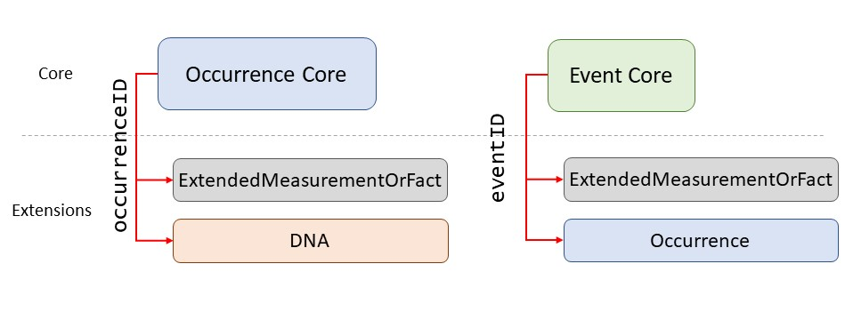

# Agenda
- What is OBIS
- What are relevant data standards for eDNA
- How to format an eDNA dataset for OBIS and GBIF
- How publish DNA-derived data to OBIS

*If we have enough time*

- The OBIS eDNA QC tool
- Mapping molecular data to Darwin Core



  



 



# How do we make sure we understand data from different sources?





## Core & Extension tables

:::: {.columns}
::: {.column width="65%"}
- Every Darwin Core Archive has **one core table**: either **Event** or **Occurrence**
- Plus zero, one, or more **extension** tables (eMoF, DNA extension...)
- Extensions link back to the core via an ID
:::
::::
{fig-align="center" width="60%"}

# What about eDNA data?









# How do we publish DNA-derived data ?
 Your data needs to be in the right [format]{.repo} + using the right [vocabulary]{.repo}



  









        

    





# Publishing to OBIS





## Special cases









   

# Resources











# Mapping molecular data to Darwin Core
 Which information is entered where? A short exercise

   

         



   





      
